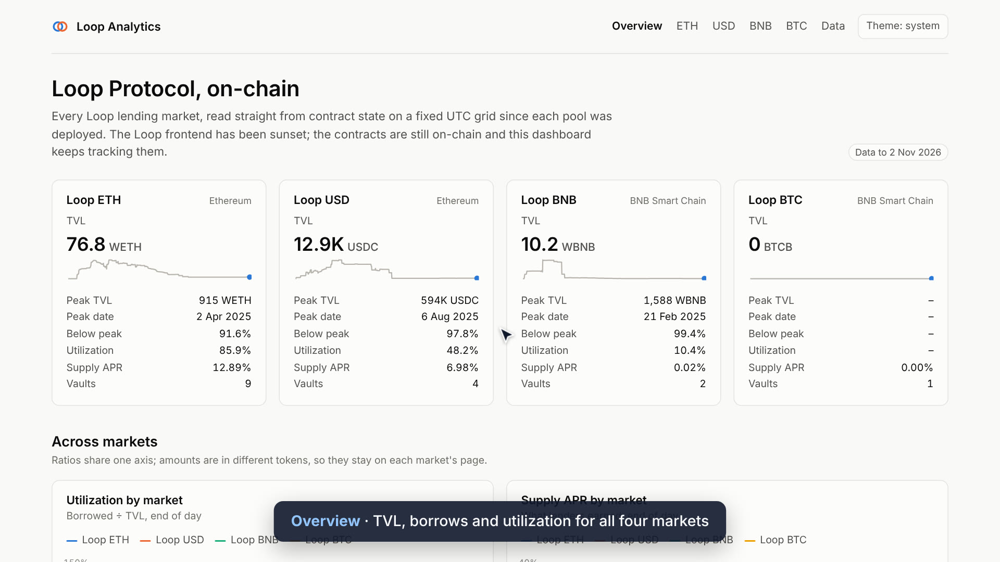
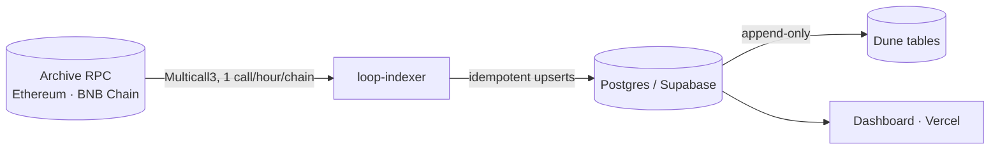
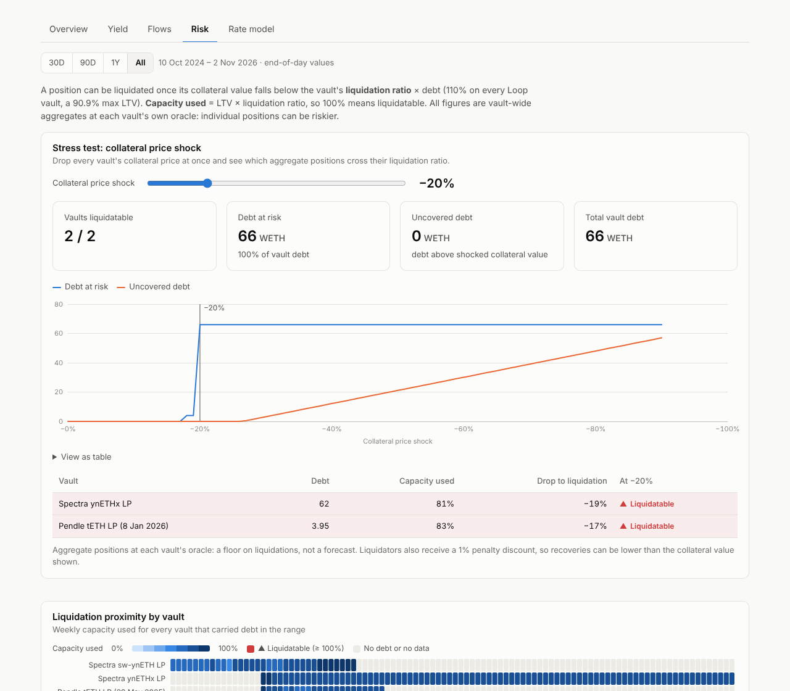

# Loop Dune

[](https://github.com/guilyx/loopscan/actions/workflows/ci.yml)
[](https://github.com/guilyx/loopscan/actions/workflows/codeql.yml)
[](https://guilyx.github.io/loopscan/)
[](LICENSE)


On-chain analytics for **Loop Protocol**'s lending markets. Every pool and CDP vault is
read straight from contract state on an hourly UTC grid since deployment, stored in
Postgres, published to Dune, and shown on a dashboard.

**[Documentation](https://guilyx.github.io/loopscan/)** ·
[Dashboard tour](https://guilyx.github.io/loopscan/dashboard/) ·
[Data model](https://guilyx.github.io/loopscan/data-model/) ·
[API](https://guilyx.github.io/loopscan/api/) ·
[Hosting](https://guilyx.github.io/loopscan/deployment/)

[](https://guilyx.github.io/loopscan/#loop-dune)
<sub>▶ Watch the 75-second demo on the [documentation site](https://guilyx.github.io/loopscan/)
(or [download the MP4](docs/assets/demo.mp4)).</sub>

| | |
|---|---|
| **Markets** | lpETH and lpUSD on Ethereum; lpBNB and lpBTC on BNB Chain |
| **Coverage** | 4 pools, 4 staking vaults, 16 CDP vaults, 146 series, from each pool's deployment block |
| **Resolution** | hourly (UTC), with daily rollups |
| **Outputs** | Postgres views · public Dune tables · Next.js dashboard · JSON/CSV API |

> The Loop frontend has been sunset. The contracts are still on-chain, so the data can
> still be read, audited and charted. See [the findings](#findings).

## How it works



* **[Registry](indexer/src/loop_indexer/markets.yaml) verified on-chain.** Tokens,
  decimals, deployment blocks and each pool's vault list are re-checked against the chain
  (`loop-indexer registry verify`).
* **One UTC grid for every chain.** "State as of 14:00 UTC" means the last block at or
  before 14:00 on each chain, so Ethereum and BNB Chain series join row for row.
* **Exact and honest.** Raw `uint256` is kept alongside scaled values. A reverting call
  is recorded as missing, never as zero.
* **Self-healing.** Every run fills every missing hour since deployment. Re-runs are
  no-ops, and outages repair themselves on the next run.

Details: [architecture](docs/architecture.md) · [data model](docs/data-model.md) ·
[deployment](docs/deployment.md) · [VPS](docs/vps.md) · [backups](docs/backups.md) ·
[Dune](dune/README.md).


## Analytics

Every market page has five tabs, all scoped by one date-range filter:

| Tab | What it answers |
|---|---|
| **Overview** | TVL, borrows, utilization, rates, collateral vs debt, share price, staked/locked, vault table |
| **Yield** | What lenders *actually* earned (realized APY from the share price, 7/30/90 days) vs the quoted APR; cumulative interest; how much borrower interest reached lenders |
| **Flows** | Each day's TVL change split exactly into interest and net deposits; weekly deposits/withdrawals and borrows/repayments |
| **Risk** | Interactive **stress test** (collateral price shock → vaults past their liquidation ratio, debt at risk, uncovered debt); liquidation-proximity heatmap; debt mix and concentration (HHI); oracle events |
| **Rate model** | Utilization vs borrow APR for every day, with the empirical rate curve, and how often the pool ran hot |

The definitions live once, in SQL views (`loop.market_yield_daily`,
`loop.market_flows_daily`, …), and are mirrored by the [Dune queries](dune/queries/).
A data-health panel shows coverage per chain and every reverting series.



## Quick start

Requirements: [uv](https://docs.astral.sh/uv/), Node 20+, and Docker (or any Postgres ≥ 14).

```bash
cp .env.example .env          # add archive RPC URLs
make setup                    # Python + Node dependencies
make db migrate               # local Postgres + schema
make verify                   # check the registry against the chain
make backfill                 # daily snapshots since deployment (~1.5k points)
make run                      # fill in hourly resolution
make export-static dashboard  # http://localhost:3000
```

The dashboard also runs with **no database**: `cd dashboard && npm ci && npm run dev`
serves the committed snapshot in `dashboard/data/`.

## Hosting

Two ready-made setups, nothing deployed until you switch it on:

| | Managed | Single VPS |
|---|---|---|
| Stack | Supabase + GitHub Actions + Vercel | Docker Compose: Postgres, indexer, dashboard, Caddy (HTTPS), backups |
| Set up | [docs/deployment.md](docs/deployment.md) | `bootstrap.sh` + one `.env` ([docs/vps.md](docs/vps.md)) |
| Deploys | Vercel on push | GHCR images on push, optional SSH roll-forward and one-click rollback |
| Backups | Supabase | Daily, age-encrypted, offsite to any S3 bucket, restore-drilled weekly in CI ([docs/backups.md](docs/backups.md)) |

## Using the data

| Where | How |
|---|---|
| Postgres | `loop.market_hourly`, `loop.vault_hourly`, `loop.market_daily`, … ([data model](docs/data-model.md)) |
| Dune | `dune.<namespace>.loop_observations` + catalogue tables, and [ready-made queries](dune/queries/) |
| HTTP | `/api/markets`, `/api/markets/eth`, `/api/markets/eth?format=csv` |

```sql
-- utilization and supply APR, end of day
select day, market_id, utilization, supply_apr
from loop.market_daily
order by day desc, market_id;
```

## Findings

The indexer surfaced things the protocol's own accounting hid:

* **A vault borrowed 120k USDC against dust.** The `syrupUSDC` vault's oracle reports
  prices scaled 1e30 instead of 1e18. Read as 1e18, 0.000000059 LP tokens look like about
  $150k of collateral. Debt peaked at 124k USDC. 4,000 USDC is still outstanding.
* **10 of 16 vaults were never tracked** by the previous pipeline, including vaults with
  debt. Its BNB pool metrics read an Ethereum address and were always zero.
* **Lenders took losses.** The lpETH share price peaked at 1.0155 (5 Feb 2025) and fell
  to 1.0012 by mid-2025, a ~1.4% loss of deposit value. lpUSD shows similar write-downs
  (largest single day −4,195 USDC, 26 Sep 2025).
* **The rate model was retuned.** At 75–85% utilization, lpETH charged ~21% APR before
  June 2025 and ~7% after, visible as two separate curves on the Rate model tab (only 5
  days fall in that band after June).
* **An oracle collapsed.** sdeUSD's price fell 90% in one day (7 Nov 2025) and its oracle
  has reverted ever since; 2,236 USDC of debt sits in a vault that can no longer be valued.
* **TVL is 92–99% below its peak.** lpETH went from 915 to 77 WETH, lpUSD from 594k to
  12.9k USDC, and lpBNB from 1,588 to 10 WBNB (2 Nov 2026). lpBTC shows no deposits in
  any daily sample. What remains on lpETH is still 86% borrowed.

More in [docs/data-model.md](docs/data-model.md#findings-in-the-data). The audit of the
old pipeline is in [docs/legacy-review.md](docs/legacy-review.md).

## Repository

```
indexer/      Python indexer: registry, chain client, pipeline, Postgres, exporters, CLI
supabase/     SQL migrations: tables, analysis views, read-only role
dashboard/    Next.js dashboard and JSON/CSV API (Postgres or static snapshot)
deploy/       VPS stack (compose, Caddy, provisioning, stack.sh) and the backup image
dune/         DuneSQL queries over the exported tables
docs/         documentation site (MkDocs): guides, references, demo video
scripts/      demo-video recorder
.github/      CI, CodeQL, docs site, hourly indexer, image release + VPS deploy, restore drill
```

## Development

```bash
make lint     # ruff, ruff format, mypy --strict, tsc
make test     # pytest (in-memory EVM + Postgres via TEST_DATABASE_URL) and vitest
make docs     # documentation site, strict (broken links fail)
```

Contributions are welcome: see [CONTRIBUTING.md](CONTRIBUTING.md), the
[code of conduct](CODE_OF_CONDUCT.md) and the [security policy](SECURITY.md).
Changes are listed in the [changelog](CHANGELOG.md).

## License

[GPL-3.0](LICENSE).
