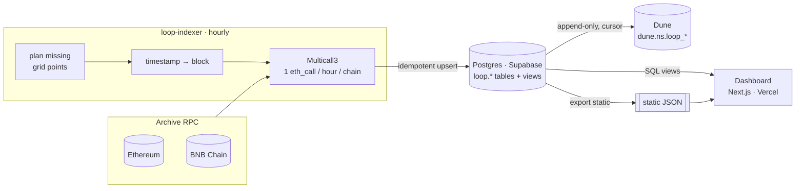

# Architecture

| Piece | Where | Runs on |
|---|---|---|
| Indexer (Python) | `indexer/` | GitHub Actions cron (or any container host) |
| Schema + views | `supabase/migrations/` | Supabase Postgres (or any Postgres ≥ 14) |
| Dune export | `loop-indexer export dune` | same job, after indexing |
| Dune queries | `dune/queries/` | Dune |
| Dashboard | `dashboard/` | Vercel (or the bundled Docker image) |

## Decisions

### 1. Snapshot contract *state*, not events

Most of what matters for a lending market is only available from view functions:
accrued interest (`expectedLiquidity`), the interest-rate model output
(`baseInterestRate`, `supplyRate`) and oracle prices (`spotPrice`). Reconstructing
these from events would mean re-implementing the protocol's math. Reading the state at
a block is exact by definition.

Anything that *is* naturally event-shaped (individual deposits, liquidations) can still
be built on Dune from decoded logs and joined to these tables on `ts`.

### 2. One UTC grid for every chain

Every chain is sampled at the same instants (top of each hour, UTC). The block for an
instant is **the last block with `timestamp <= instant`**, so a row means "the state as
of 14:00 UTC". Ethereum (12 s blocks) and BNB Chain (3 s → 1.5 s → 0.75 s blocks over the
period) therefore line up and can be joined without interpolation. The legacy collector
sampled every N blocks, which drifted against wall-clock time and changed cadence
whenever N was edited.

Timestamp → block uses the `BlockResolver`. It interpolates from the nearest known
blocks, then fetches a 16-header window around the guess plus "fence" probes at ±64,
±512 and ±4,096 blocks, all in one JSON-RPC batch. If the window misses because block
rates drift, the fences have still narrowed the bracket enough for an exact secant guess
on the next round, instead of a long bisection. Every snapshot's block becomes an anchor
for the next one. Measured on mainnet: about 1 round trip per hourly step, 2 per daily
step, and 8–10 for a cold start.

### 3. Multicall3, one call per snapshot

All active series on a chain (83 on Ethereum, 31 on BNB Chain) are read in a single
`aggregate3` `eth_call` with `allowFailure = true`. A reverting call (a stale oracle,
for example) fails only that series and is recorded in `snapshots.failed_series`. The
indexer never writes a fabricated zero.

### 4. Long fact table + views

`loop.observations` holds one row per (series, hour): the exact `uint256` as
`numeric(78,0)` plus the scaled value. Wide, analysis-friendly shapes are SQL views
(`market_hourly`, `vault_hourly`, daily rollups). The consequences:

* adding a metric or a vault is a registry change, never a migration;
* two markets cannot drift into different column layouts (the legacy CSVs had);
* derived metrics (utilization, LTV, share prices) are defined once, in SQL.

### 5. Registry as code, verified on-chain

`markets.yaml` lists contracts, tokens and deployment blocks, and nothing else. The
metrics are generated per entity type, so every pool gets the same 7 series and every
vault the same 5. `loop-indexer registry verify` re-reads every fact from the chain:
decimals, `asset()` and `token()` links, deployment blocks, and the pool's
`creditManagers()` list. It runs weekly in CI, so a vault added to a pool fails loudly
instead of going untracked (the legacy config missed 10 of 16 vaults).

### 6. Idempotent, self-healing runs

Each run computes *every* grid point since deployment that has no snapshot and fills
it, so a failed hour, an RPC outage or a week of downtime is repaired by the next
successful run. All writes are upserts. A re-sample that reads identical values leaves
`ingested_at` unchanged, so nothing is re-exported. A run that could not fill every
point exits non-zero, which fails the workflow and notifies you.

### 7. At-least-once delivery to Dune

The Dune exporter pages through observations in `(ingested_at, series_id, ts)` order
and advances a cursor only after Dune acknowledges a batch. A crash can re-send at most
one batch, and the Dune queries de-duplicate on `(series_id, ts)` by latest
`ingested_at`. `export dune --full` clears and reloads the table.

### 8. A dashboard that works without a database

The dashboard reads Postgres views when `DATABASE_URL` is set. Otherwise it reads a
static JSON snapshot written by `loop-indexer export static`. That keeps preview
deployments, forks and the public demo working with no secrets, and both sources return
identical shapes.

## Failure modes

| Failure | Behaviour |
|---|---|
| RPC rate limit / 5xx / timeout | exponential backoff with jitter, rotate to the next endpoint |
| Non-archive node ("missing trie node") | treated as an endpoint failure → rotate |
| Call reverts | that series is skipped for that hour; listed in `failed_series` |
| Whole hour unreadable | hour stays missing, run exits 1, next run retries it |
| Dune 429 / 5xx | retried; cursor not advanced until a batch is acknowledged |
| Dune short write | run fails; cursor not advanced |
| Indexer down for days | next run backfills every missing hour |
| New vault added on-chain | weekly `registry verify` fails with the new address |
