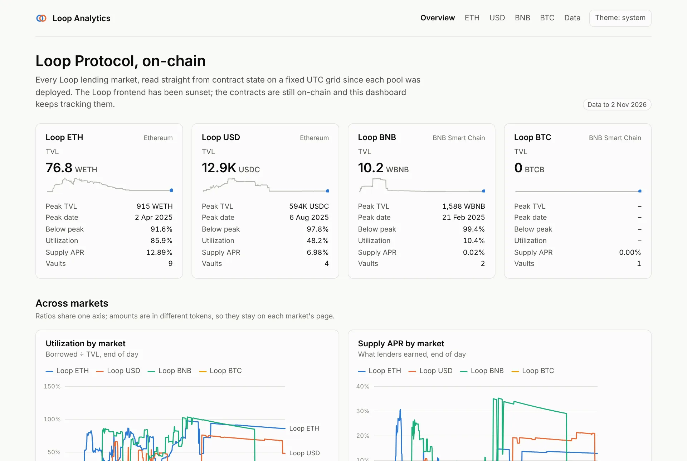
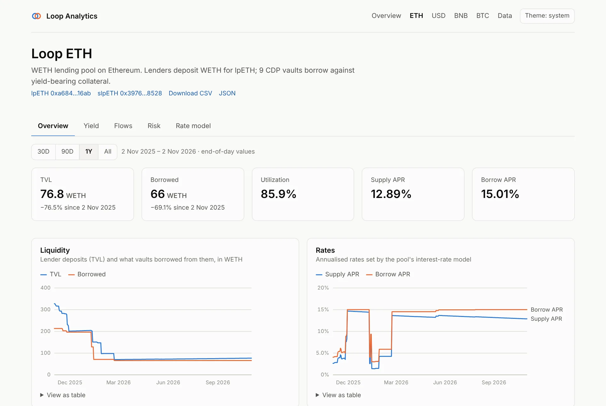
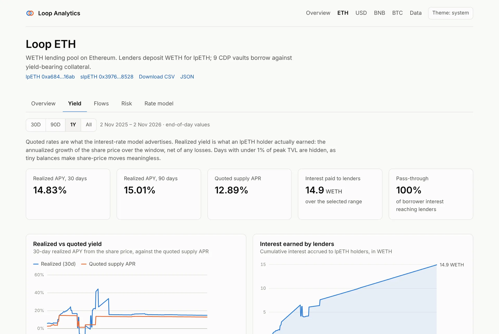
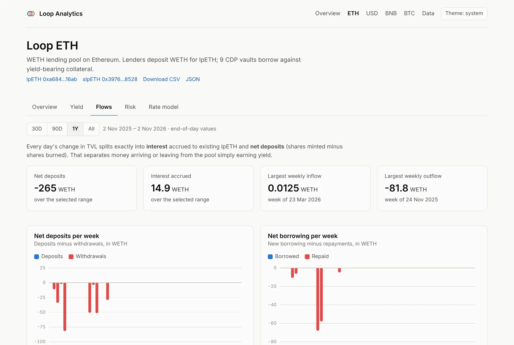
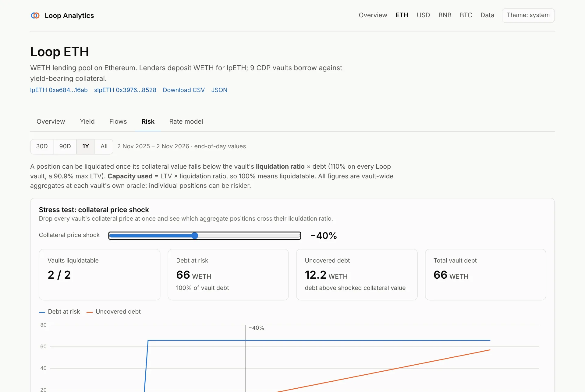
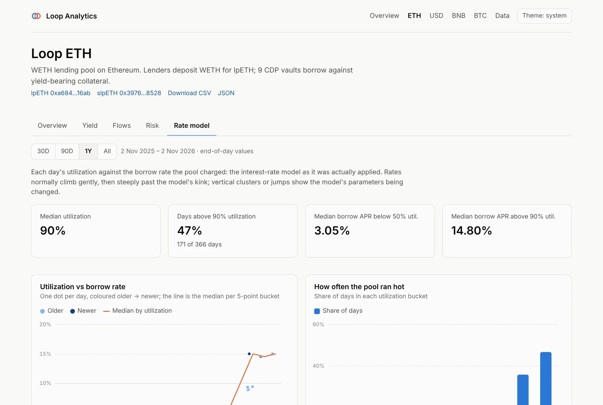
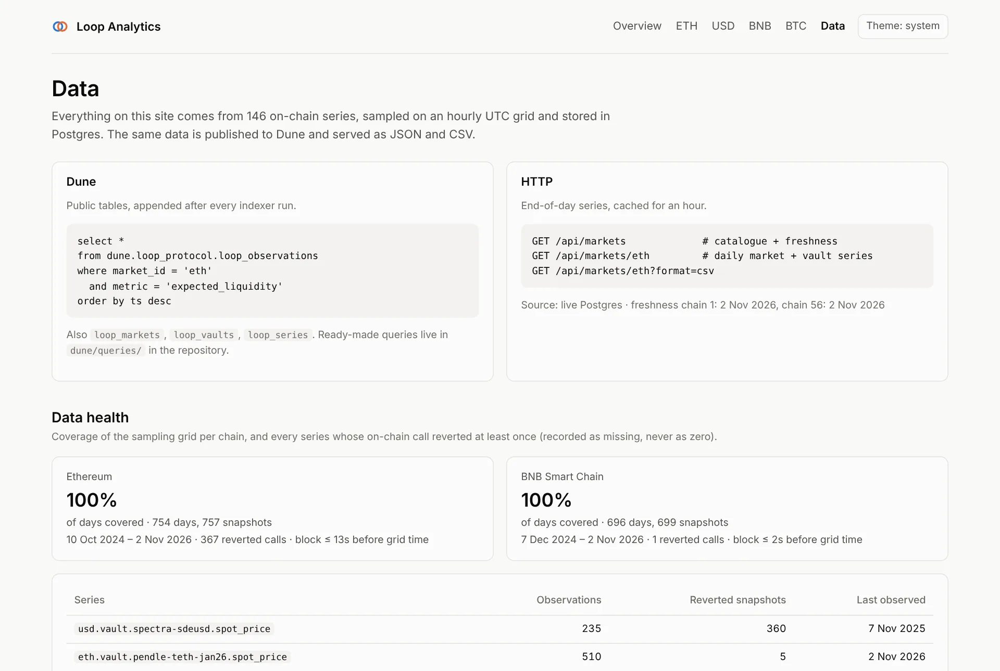

# Dashboard feature tour

The dashboard is a Next.js app in [`dashboard/`](https://github.com/guilyx/loop-dune/tree/master/dashboard).
It reads Postgres through a read-only role, or a committed static snapshot when no
database is configured. Every number on it comes from a SQL view, so the dashboard,
the [HTTP API](api.md) and the [Dune queries](dune.md) agree by construction.

!!! tip "Watch it first"
    The [75-second demo video](index.md) walks through everything on this page.

## Overview page

One card per market (lpETH, lpUSD, lpBNB, lpBTC) with the latest TVL, peak TVL and
date, drawdown from peak, utilization, supply APR and vault count, plus a sparkline.
Below, cross-market charts put utilization and supply APR for all four pools on one
axis. Amounts stay on each market's page, because they are in different tokens.

**Data findings** lists every vault-day where debt exceeded the collateral value at the
vault's own oracle (LTV above 100%): under-collateralised positions the protocol's UI
never showed.

## Market pages

Each market has five tabs and one **date-range filter** (30D, 90D, 1Y, All) that
scopes every chart and number on every tab. The header links the pool and staking
contracts on the block explorer, and the market's data as CSV and JSON.

=== "Overview"

    

    | Chart | What it shows |
    |---|---|
    | KPI tiles | TVL (with peak and date), borrowed, utilization, supply and borrow APR |
    | Liquidity | Lender deposits (TVL) vs what vaults borrowed |
    | Rates | Supply and borrow APR set by the interest-rate model |
    | Utilization | Borrowed ÷ TVL, end of day |
    | Collateral and debt | All vaults' collateral, valued at each vault's oracle, vs vault debt |
    | Share price | The lp token's exchange rate: what one lp token redeems for |
    | Staked and locked | lp tokens staked in the staking vault, and locked |
    | Vault table | Every CDP vault: collateral, debt, LTV, liquidation ratio, capacity used |

    Source: `loop.market_daily`, and `loop.vault_daily` for the vault table.

=== "Yield"

    

    **What lenders actually earned**, not what the rate model advertised.

    * **Realized APY** (30 and 90 days) is the annualised growth of the lp share price
      over the window, net of any losses.
    * **Realized vs quoted yield** charts the 30-day realized APY against the quoted
      supply APR. Gaps mean write-downs or idle liquidity.
    * **Interest earned by lenders** accumulates over the selected range.
    * **Pass-through** is the share of borrower interest that reached lenders.

    Days with under 1% of peak TVL are hidden: on tiny balances, share-price noise
    dominates. Source: `loop.market_yield_daily`.

=== "Flows"

    

    **Where TVL changes came from.** Each day's TVL change splits exactly into interest
    accrued (the share price moving) and net deposits (shares minted minus burned):

    * KPI tiles: net deposits and interest over the range, largest weekly inflow and
      outflow.
    * **Net deposits per week** and **net borrowing per week** as diverging bars.
    * **What moved TVL**: cumulative deposits vs interest since the start of the range.

    Source: `loop.market_flows_daily`.

=== "Risk"

    

    * **Stress test.** Drag the slider to drop every collateral price at once. The
      tiles show how many vaults cross their liquidation ratio, the debt at risk, and
      the *uncovered* debt (debt above the shocked collateral value). The chart shows
      the whole curve from 0 to −100%.
    * **Liquidation proximity by vault**: a heatmap of capacity used per vault and day
      (LTV × liquidation ratio, so 100% means liquidatable).
    * **Debt by vault** and **debt concentration** (Herfindahl index and top-vault
      share).
    * **Oracle events**: day-over-day collateral price moves above 20%.

    All figures are vault-wide aggregates at each vault's own oracle; individual
    positions can be riskier. Sources: `loop.vault_daily`, `loop.vault_share_daily`,
    `loop.market_concentration_daily`, `loop.oracle_daily`.

=== "Rate model"

    

    The interest-rate model **as it was actually applied**:

    * **Utilization vs borrow rate**: one dot per day, coloured older → newer, with the
      median curve per 5-point utilization bucket. Rates usually climb gently, then
      steeply past the model's kink. Two separate clusters mean the parameters changed:
      lpETH's model was retuned in June 2025.
    * **How often the pool ran hot**: the share of days in each utilization bucket.
    * KPI tiles: median utilization, days above 90%, and median borrow APR below 50%
      and above 90% utilization.

## Data page

The reference for everything behind the charts:

* how to query the same data **on Dune** and over **HTTP**,
* **data health**: share of the sampling grid covered per chain, and every series whose
  on-chain call reverted at least once (recorded as missing, never as zero),
* every **Postgres view**, one line each.

## Accessibility and usability

* Every chart has a **View as table** toggle with the exact values.
* Charts are keyboard-navigable: focus a chart and use the arrow keys to move between
  days, bars or cells; tabs follow the WAI-ARIA pattern (arrows, Home, End).
* **Light and dark themes**, following the system setting by default, with a chart
  palette validated for contrast in both.
* The selected tab is kept in the URL hash (`/markets/eth#risk`), so links open the
  same view.

## Data sources and freshness

| Mode | When | Freshness |
|---|---|---|
| Postgres | `DATABASE_URL` is set | Pages are cached for an hour and rebuilt as soon as the indexer lands new data ([on-demand revalidation](api.md#post-apirevalidate)) |
| Static snapshot | no `DATABASE_URL` (forks, previews) | The JSON in `dashboard/data/`, refreshed with `make export-static` |
