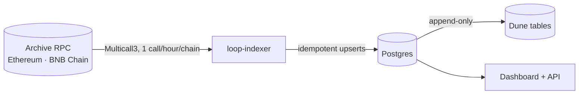

---
hide:
  - navigation
---

# Loop Dune

**On-chain analytics for Loop Protocol's lending markets.** Every pool and CDP vault is
read straight from contract state on an hourly UTC grid since deployment, stored in
Postgres, published to Dune, and shown on a dashboard.

<figure class="demo" markdown>
<video controls muted playsinline preload="metadata" poster="assets/demo-poster.jpg">
  <source src="assets/demo.mp4" type="video/mp4">
  Your browser cannot play this video. <a href="assets/demo.mp4">Download it</a>.
</video>
<figcaption>A 75-second tour of the dashboard: overview, market tabs, the stress test,
the data page and the API.</figcaption>
</figure>

<div class="grid cards" markdown>

-   **Dashboard**

    ---

    Five analysis tabs per market (Overview, Yield, Flows, Risk, Rate model), an
    interactive stress test, a data-health page and a JSON/CSV API.

    [:octicons-arrow-right-24: Feature tour](dashboard.md)

-   **Data**

    ---

    One long fact table of exact `uint256` values plus SQL views for every metric,
    mirrored as public Dune tables with ready-made queries.

    [:octicons-arrow-right-24: Data model](data-model.md) ·
    [Dune](dune.md)

-   **Indexer**

    ---

    Python, Multicall3, a registry verified on-chain, idempotent and self-healing runs.
    One call per chain per hour.

    [:octicons-arrow-right-24: Architecture](architecture.md)

-   **Hosting**

    ---

    Managed (Supabase + GitHub Actions + Vercel) or a single VPS with HTTPS,
    continuous deployment and encrypted, restore-tested backups.

    [:octicons-arrow-right-24: Choose a setup](deployment.md)

</div>

## At a glance

| | |
|---|---|
| **Markets** | lpETH and lpUSD on Ethereum; lpBNB and lpBTC on BNB Chain |
| **Coverage** | 4 pools, 4 staking vaults, 16 CDP vaults, 146 series, from each pool's deployment block |
| **Resolution** | hourly (UTC), with daily rollups |
| **Outputs** | Postgres views · public Dune tables · Next.js dashboard · JSON/CSV API |
| **Status** | The Loop frontend has been sunset; the contracts are still on-chain, so the data can still be read, audited and charted. |

## How it works



* **Registry verified on-chain.** Tokens, decimals, deployment blocks and each pool's
  vault list are re-checked against the chain (`loop-indexer registry verify`).
* **One UTC grid for every chain.** "State as of 14:00 UTC" means the last block at or
  before 14:00 on each chain, so Ethereum and BNB Chain series join row for row.
* **Exact and honest.** Raw `uint256` is kept alongside scaled values. A reverting call
  is recorded as missing, never as zero.
* **Self-healing.** Every run fills every missing hour since deployment. Re-runs are
  no-ops, and outages repair themselves on the next run.

## What the data shows

The indexer surfaced things the protocol's own accounting hid:

* **A vault borrowed 120k USDC against dust.** The `syrupUSDC` vault's oracle reports
  prices scaled 1e30 instead of 1e18. Debt peaked at 124k USDC; 4,000 USDC is still
  outstanding.
* **Lenders took losses.** The lpETH share price peaked at 1.0155 (5 Feb 2025) and fell
  to 1.0012 by mid-2025, a ~1.4% loss of deposit value.
* **The rate model was retuned.** At 75–85% utilization, lpETH charged ~21% APR before
  June 2025 and ~7% after: two separate curves on the Rate model tab.
* **An oracle collapsed.** sdeUSD's price fell 90% in one day (7 Nov 2025) and its oracle
  has reverted ever since.

More in [the data model](data-model.md#findings-in-the-data).

## Quick start

Requirements: [uv](https://docs.astral.sh/uv/), Node 20+, and Docker (or any Postgres ≥ 14).

```bash
git clone https://github.com/guilyx/loop-dune && cd loop-dune
cp .env.example .env          # add archive RPC URLs
make setup                    # Python + Node dependencies
make db migrate               # local Postgres + schema
make backfill                 # daily snapshots since deployment
make run                      # fill in hourly resolution
make export-static dashboard  # http://localhost:3000
```

No database or RPC handy? The dashboard runs on the committed snapshot:
`cd dashboard && npm ci && npm run dev`.
