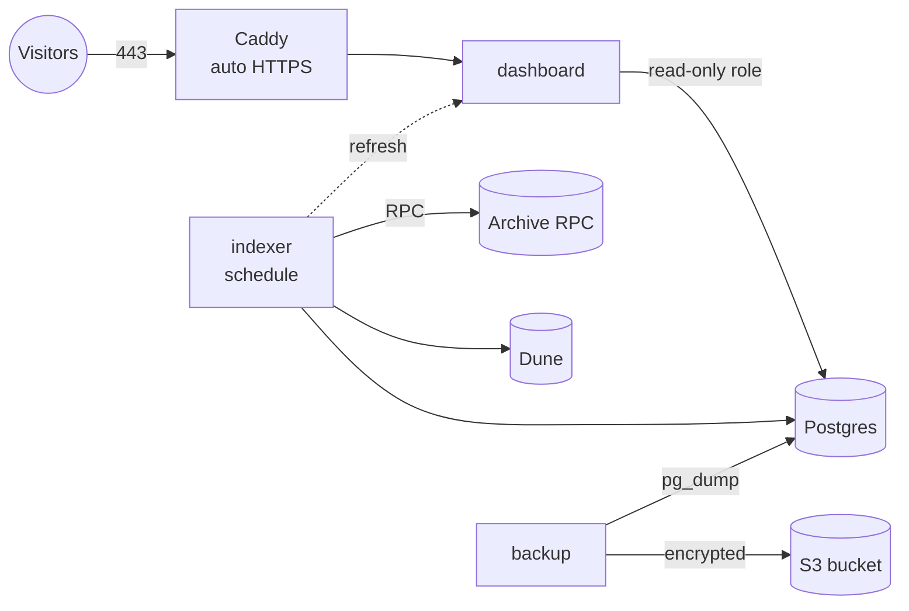

# Running on a VPS

One server runs the whole stack: Postgres, the hourly indexer, the dashboard behind
HTTPS, and encrypted backups. It replaces Supabase + GitHub Actions + Vercel
([deployment.md](deployment.md)); pick one of the two, not both.



| | |
|---|---|
| **Size** | 2 vCPU / 2 GB RAM / 40 GB disk is plenty (Hetzner CX22, DigitalOcean, OVH...). The full hourly history is ~700 MB in Postgres. |
| **OS** | Ubuntu 22.04/24.04 or Debian 12 |
| **Exposed** | 22 (SSH), 80/443 (Caddy). Postgres and the dashboard have no internet route. |
| **Files** | [`deploy/vps/`](https://github.com/guilyx/loopscan/tree/master/deploy/vps): `docker-compose.yml`, `Caddyfile`, `.env.example`, `stack.sh`, `bootstrap.sh` |

## Set up (about 20 minutes)

**1. Provision** (as root, on a fresh server with your SSH key installed):

```bash
curl -fsSL https://raw.githubusercontent.com/guilyx/loopscan/master/deploy/vps/bootstrap.sh | sudo bash
```

It installs Docker, opens only 22/80/443, enables unattended security upgrades and
fail2ban, switches SSH to key-only, adds swap on small boxes, creates a `loop` user,
clones the repo to `/opt/loop-dune` and writes `deploy/vps/.env` with random
database passwords. Read it first: it is ~140 lines.

**2. Configure** `/opt/loop-dune/deploy/vps/.env` (as `loop`):

| Setting | What to put |
|---|---|
| `DOMAIN`, `ACME_EMAIL` | Your hostname; Caddy fetches the certificate itself. `DOMAIN=:80` serves plain HTTP on the IP while DNS is pending. |
| `ETH_RPC_URLS`, `BSC_RPC_URLS` | Archive RPC endpoints (comma-separated for failover) |
| `DUNE_API_KEY`, `DUNE_NAMESPACE` | Optional: public Dune tables |
| `BACKUP_AGE_RECIPIENTS`, `BACKUP_REMOTE`, `OFFSITE_S3_*` | Backups: see [backups.md](backups.md). Do this before going live. |
| `INDEXER_HEARTBEAT_URL`, `BACKUP_HEARTBEAT_URL` | Optional, recommended: alert when a job stops reporting |

**3. Point DNS** (an `A`/`AAAA` record for `DOMAIN`) at the server.

**4. Start:**

```bash
/opt/loop-dune/deploy/vps/stack.sh deploy
```

This pulls the images, starts everything, waits for the health checks and prints the
status. On first start the indexer applies the migrations and back-fills from each
pool's deployment block. A full hourly backfill takes a while (it depends on your RPC
plan); a daily backfill first gets the charts up in minutes:

```bash
/opt/loop-dune/deploy/vps/stack.sh indexer run --interval 1d
```

## Images

`.github/workflows/release.yml` publishes three images to GHCR on every push to
`master`, tagged with the commit SHA and `latest`:

* `ghcr.io/guilyx/loop-dune-indexer`
* `ghcr.io/guilyx/loop-dune-dashboard`
* `ghcr.io/guilyx/loop-dune-backup`

GHCR packages start private. Either make them public once (package settings → *Change
visibility*), or log the server in with a token that has `read:packages`:
`docker login ghcr.io -u <user>`. For an ARM server, set the repository variable
`IMAGE_PLATFORMS=linux/amd64,linux/arm64`.

No registry at all? `stack.sh build` builds the images on the server from the checkout.

## Continuous deployment (optional)

After the images are published, the same workflow can SSH in and roll the server
forward to that exact commit (compose file from git, images by SHA).

1. On your machine, make a deploy key and authorize it for `loop` on the server:
   ```bash
   ssh-keygen -t ed25519 -N '' -C loop-deploy -f loop-deploy
   ssh-copy-id -i loop-deploy.pub loop@<server>
   ```
2. Repository **secrets**: `VPS_HOST`, `VPS_USER` (`loop`), `VPS_SSH_KEY` (contents of
   `loop-deploy`), `VPS_KNOWN_HOSTS` (output of `ssh-keyscan -t ed25519 <server>`).
3. Repository **variable** `VPS_DEPLOY_ENABLED=true`. Optionally add required reviewers
   to the `production` environment for a manual approval step.

**Roll back:** run the *Release* workflow by hand with `deploy_tag` set to an earlier
commit SHA. It skips the build and redeploys those images. On the server,
`stack.sh deploy <sha>` does the same.

## Day to day

| Task | Command (`stack.sh` = `/opt/loop-dune/deploy/vps/stack.sh`) |
|---|---|
| Health at a glance | `stack.sh status` (containers, lag per chain, last backup) |
| Logs | `stack.sh logs -f indexer` (also `dashboard`, `caddy`, `backup`, `db`) |
| Deploy / roll back | `stack.sh deploy [sha]` |
| One-off indexer command | `stack.sh indexer run --from 2025-01-01 --to 2025-02-01` |
| SQL shell | `stack.sh psql` |
| Back up now / list | `stack.sh backup` / `stack.sh backups` |
| Restore | `stack.sh restore latest ~/loop-backup.key` ([backups.md](backups.md)) |
| Restart one service | `stack.sh restart dashboard` |
| Rotate the dashboard DB password | `stack.sh psql -c "alter role dashboard password '…'"`, update `.env`, `stack.sh up -d dashboard` |

How the pieces behave:

* **Indexer** runs `loop-indexer schedule`: every hour at :17 it indexes the missing
  hours, exports to Dune, refreshes the dashboard and checks freshness, then pings
  `INDEXER_HEARTBEAT_URL` (`/fail` if a step failed). A failed step never stops the
  next hour, and a restart or outage is caught up automatically on the next cycle.
  `docker stop` waits for the current snapshot to finish.
* **Dashboard** reads through the `dashboard` role, which can only `select` from the
  `loop` schema. Pages are cached and rebuilt right after each indexer cycle.
* **Caddy** renews certificates on its own and adds HSTS and basic security headers.
* **Postgres** is tuned for a 2 GB box; raise `PG_SHARED_BUFFERS` (~25% of RAM) and
  `PG_EFFECTIVE_CACHE_SIZE` (~75%) on a bigger one.
* **Logs** rotate at 10 MB × 5 files per container.

## Monitoring

Use any dead-man's-switch service (healthchecks.io has a free tier):

| Check | URL setting | Expect a ping every |
|---|---|---|
| Indexer cycle | `INDEXER_HEARTBEAT_URL` | 1 hour (grace ~1 hour) |
| Backup | `BACKUP_HEARTBEAT_URL` | 1 day (grace ~6 hours) |
| Restore drill | `RESTORE_DRILL_HEARTBEAT_URL` (GitHub secret) | 1 week |

Pings carry a short summary in the body, so the alert says what failed. Add an uptime
check on `https://<DOMAIN>/api/markets` for the dashboard itself.

## Security notes

* Secrets live only in `deploy/vps/.env` (mode 600, git-ignored) and GitHub secrets.
* The backup private key is never on the server: a stolen server cannot read the
  offsite history.
* Containers run as non-root users (indexer `uid 10001`, dashboard `node`, backup
  `postgres`).
* Docker publishes ports through its own iptables rules, past `ufw`. Only Caddy
  publishes ports, so this changes nothing here; keep it that way.
